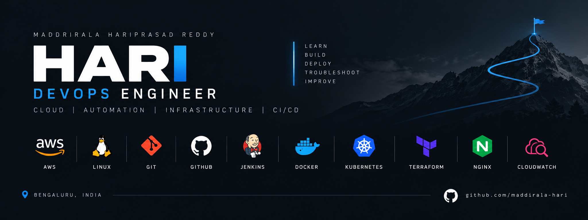

# Hi, I'm Hari 👋

### Aspiring DevOps Engineer | AWS Cloud | CI/CD | Automation

Building practical DevOps skills through hands-on cloud deployments, CI/CD pipelines, infrastructure automation, and troubleshooting.

[GitHub Profile](https://github.com/maddirala-hari) · [Explore Projects](https://github.com/maddirala-hari?tab=repositories)

---

## 👨‍💻 About Me

I'm an aspiring DevOps Engineer based in Bengaluru, India, focused on building practical skills in cloud infrastructure, deployment automation, and system troubleshooting.

- ☁️ Practicing AWS infrastructure and cloud deployments
- 🐧 Working with Linux, Git, and GitHub
- 🔄 Building CI/CD workflows using Jenkins
- 🐳 Learning containerization with Docker
- ☸️ Developing Kubernetes skills
- 🏗️ Practicing Infrastructure as Code using Terraform
- 🔍 Learning application troubleshooting, logs, and monitoring
- 🚀 Focused on building reliable, automated deployment workflows

## 💼 Professional Background

- **Current career focus:** DevOps Engineering
- **Location:** Bengaluru, Karnataka, India
- **Company:** Venus Universal Limited
- **Professional background:** Civil Engineering, alongside practical DevOps learning and project work

*Please ensure the company name above reflects your actual employment and add your official job title and employment dates in your GitHub profile settings if applicable.*

## 🛠️ Technical Skills

| Category | Tools and Technologies |
|---|---|
| Cloud Platform | Amazon Web Services (AWS) |
| AWS Services | EC2, S3, CloudFront |
| Operating Systems | Linux, Ubuntu |
| Version Control | Git, GitHub |
| CI/CD | Jenkins |
| Containers | Docker |
| Container Orchestration | Kubernetes |
| Infrastructure as Code | Terraform |
| Web Server | Nginx |
| Configuration | YAML |
| Networking | HTTP/HTTPS, DNS, Security Groups |
| Monitoring | AWS CloudWatch fundamentals |

## 🚀 Featured Projects

### 1. Employee App — CI/CD Deployment Practice
A Node.js employee application deployment project using GitHub, Jenkins, and AWS EC2.

**Focus:** Application deployment, CI/CD workflow, and build verification.

### 2. AWS Static Website Deployment
Hands-on practice deploying a static website to AWS infrastructure.

**Focus:** Website hosting, server deployment, and connectivity troubleshooting.

### 3. AWS S3 + CloudFront Deployment
Static website hosting and content delivery practice using Amazon S3 and CloudFront.

**Focus:** Cloud storage, content delivery, and website access.

### 4. Linux & Git Troubleshooting Lab
A practical lab for Linux commands, Git operations, and troubleshooting common issues.

**Focus:** Command-line operations, version control, and problem-solving.

### 5. EC2 Website Deployment
A static website deployment exercise using GitHub and an AWS EC2 instance.

**Focus:** Git-based code delivery, Nginx, and web server deployment.

[View All Repositories →](https://github.com/maddirala-hari?tab=repositories)

## 🎯 Current Learning Goals

- Strengthen AWS architecture and security fundamentals
- Build Jenkins CI/CD pipelines
- Containerize applications using Docker
- Deploy and manage applications on Kubernetes
- Automate infrastructure using Terraform
- Troubleshoot deployment failures using logs and monitoring
- Practice production-style HTTPS, DNS, and load balancing

## 📈 My Approach

**Learn → Build → Deploy → Troubleshoot → Monitor → Improve**

I focus on practical implementation and documenting what I learn through projects and labs.

## 📫 Connect

- **GitHub:** [maddirala-hari](https://github.com/maddirala-hari)
- **Linkedin:** [maddirala hariprasad Reddy](https://www.linkedin.com/in/maddiralahari)
- **Location:** Bengaluru, India

---

### Build. Automate. Deploy. Improve.

